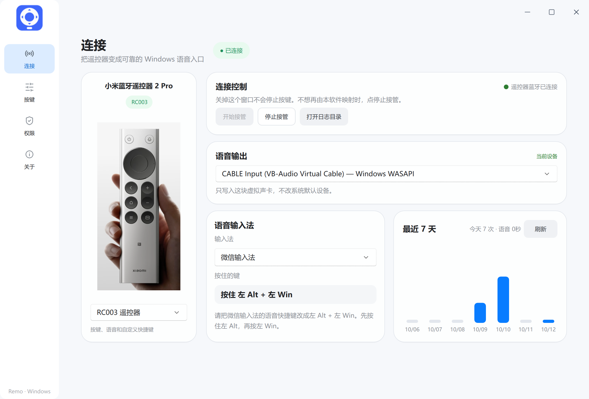
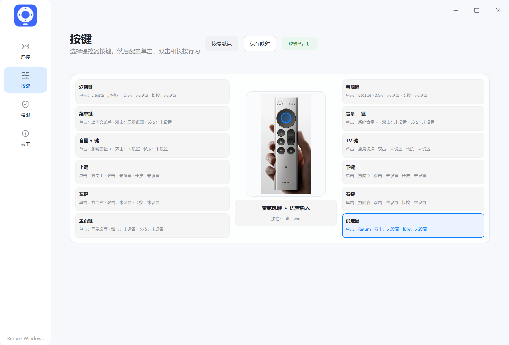
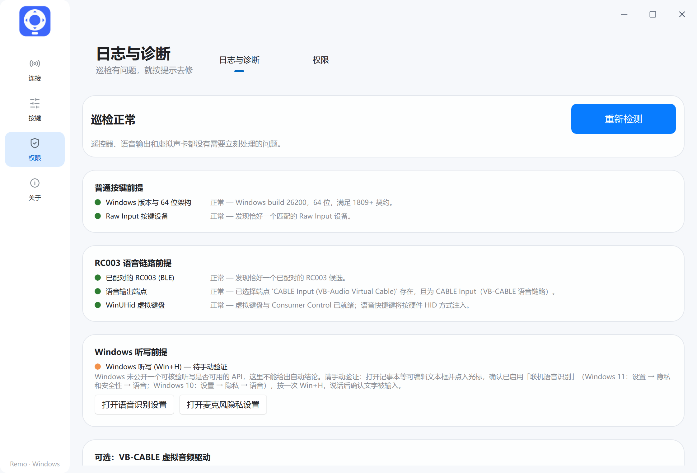

# Remo

Remo 把小米蓝牙遥控器 2 Pro（RC003）变成 Windows 上的键盘和麦克风。方向键、确定、返回和音量可以照常使用，按住麦克风键就能对着微信输入法、豆包等说话。

设置只保存在这台电脑上。关掉设置窗口不会停止按键；不想再由 Remo 映射时，在连接页点「停止接管」。

## 主要功能

**按键。** 遥控器上的键可以分别设置单击、双击和长按。默认是方向键、回车、退格、系统音量、显示桌面、上下文菜单、应用切换和 Esc。遥控器没有单独的静音键，静音只能自己加到某个键上。

**语音。** 按住麦克风时，声音写进你选中的播放设备，通常是 VB-CABLE 的 CABLE Input。输入法再从 CABLE Output 收音。Remo 不改 Windows 的默认录音设备。

输入法有现成预设：

| 输入法 | 按住麦克风时 |
| --- | --- |
| 微信输入法 | 先左 Alt，再左 Win |
| 豆包 | 右 Alt |
| 千问 | 右 Ctrl |
| 网易叭哥说 | 左 Alt |

也可以改成自己的快捷键。语音链路中断时，Remo 会重新准备麦克风，不用每次手动重开。

**连接状态。** 右上角的绿色「已连接」表示遥控器的蓝牙链路是通的。已经配对但无线电没连上时，这里显示「已配对，遥控器未连接」，不会一直保持绿色。

**开机自启。** 在「权限」里，默认关闭。打开之后，登录 Windows 才会启动遥控器后台。

## 界面

窗口是浅色的。背景 `#f6f8fb`，卡片接近白色，圆角大约 21，文字用微软雅黑。左侧是 112 宽的导航，当前页用浅蓝底。蓝色 `#087cff` 只标当前页和主要按钮，绿色只表示已经连上或检查通过。

四个页面：

- **连接。** 左边是遥控器，右边是接管、语音输出、输入法和最近 7 天的使用。
- **按键。** 中间是遥控器照片，周围是每个键的单击、双击和长按。
- **权限。** 同一区里还有「日志与诊断」：检查系统、蓝牙、虚拟声卡和语音输出是否就绪，并可以打开蓝牙设置或导出日志。日志里只有运行状态和按键名，没有录音。
- **关于。** 版本、设备、音频通路和 GPL-3.0-only 许可。







## 代码

| 目录 | 作用 |
| --- | --- |
| `apps/windows/rc003` | 设置窗口（Python、PySide6、Qt Quick） |
| `apps/windows/remo-rust` | 按键和语音后台 `remo-daemon` |
| `device-profiles/xiaomi-rc003.json` | RC003 的按键用途表 |

## 本地运行

需要 64 位 Windows 10 1809 或更高版本，以及已配对的 RC003。

```powershell
Set-Location apps\windows\rc003
py -3.12 -m venv .venv
.\.venv\Scripts\python.exe -m pip install -r requirements.txt
$env:PYTHONPATH = Join-Path (Get-Location) 'src'
$env:QML_DISABLE_DISK_CACHE = '1'
.\.venv\Scripts\python.exe -m ovb_rc003 --settings
```

设置窗口会拉起 `remo-daemon`。要从源码单独编译后台：

```powershell
Set-Location apps\windows\remo-rust
cargo build --release --bin remo-daemon
.\target\release\remo-daemon.exe --backend ble --execute
```

在 Windows 里把遥控器配对好，在连接页把语音输出选成 CABLE Input，再按输入法的要求设好它自己的语音快捷键。

## 许可

代码以 [GPL-3.0-only](LICENSE.md) 发布。来源和第三方组件见 [COPYRIGHT.md](COPYRIGHT.md) 与 [THIRD_PARTY_NOTICES.md](THIRD_PARTY_NOTICES.md)。

Windows 客户端改自 [open-voice-bridge](https://github.com/nijez/open-voice-bridge)。返回键和音量键的 HID 读取参考了 [remote-bridge-hub](https://github.com/xxb26553663-star/remote-bridge-hub)。VB-CABLE 是 VB-Audio 的独立软件，Remo 只在用户选中它时把声音写进去。
